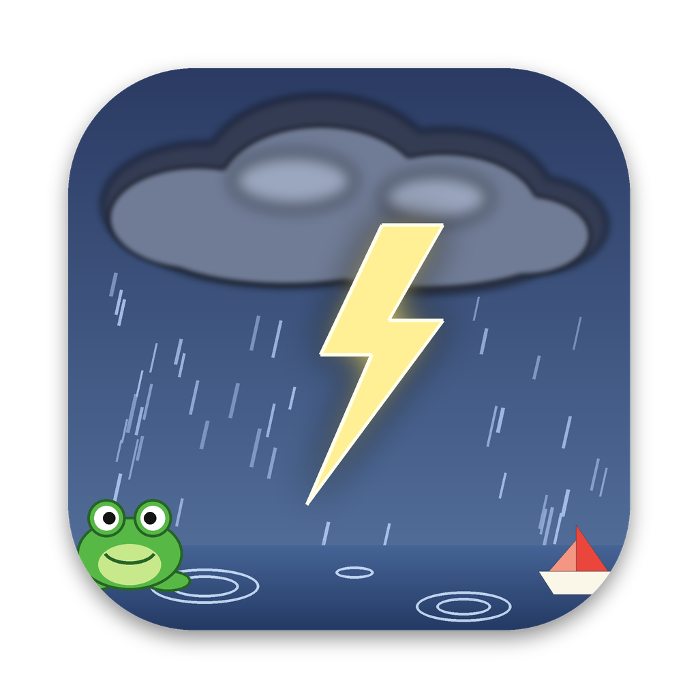

# 🌧️ Monsoon Vibes

A living rain season on your Mac desktop. One Swift file, everything drawn in code.

## What it does

**A weather system that changes by itself**

The weather moves between clear sky, drizzle, steady rain, a downpour, and a thunderstorm. You can also pick one from the menu. Everything on screen reacts to how hard it is raining.

- 🌧️ **Rain:** three depth layers of streaks, slanted by the wind, with gusts
- 💦 **Splashes:** drops splash on top of your windows and ripple in puddles at the bottom of the screen (on top of the Dock)
- ⛈️ **Thunderstorms:** lightning flashes and bolts, dark storm clouds
- 🌫️ **Mist:** drifts along the ground
- 🛶 **Puddles:** fill up as it rains, and little paper boats sail on them
- 🌈 **Rainbow:** appears after the rain stops, in daylight
- 🐸 **Frogs:** sit on your windows, hop between them and say "ribbit!" (more active in the rain and at night)

**It follows the real time of day**

| Time | Look |
|---|---|
| Day | soft grey-blue sky, rainbows possible |
| Golden hour | warm tint, glowing mist and clouds |
| Dusk | purple tint |
| Night | deep blue sky, dark clouds, stars on clear nights, thunderstorms more likely, frogs out |

**Interactive**

- ☂️ An **umbrella follows your mouse** and catches the rain. Raindrops splash on it.
- 💨 **Swipe the mouse quickly** to gust the rain sideways.
- 🐸 Frogs hop away if your mouse moves fast near them.
- Menu bar buttons: **⚡ Strike lightning** and **🌈 Make a rainbow**.

Clicks pass straight through the overlay, so it never gets in your way.

## Install

1. Install Apple's developer tools (one time): `xcode-select --install`
2. Run:
   ```
   git clone https://github.com/tanaykakade/monsoon_vibes.git
   cd monsoon_vibes
   zsh make_app.sh
   ```
3. Drag `Monsoon Vibes.app` into your Applications folder and open it.
4. macOS asks to use your location. Click **Allow While Using App**. It is only used to know whether it is day or night where you are, and never leaves your Mac. If you decline, the app estimates from your time zone.

## Menu bar

Click the menu bar icon to see the current weather, pick a weather type, turn each feature on or off, pause, or **Quit**.

You can also change the time of day:

- **Real time:** the default
- **Time lapse:** a whole day in 2 minutes
- **Preview: noon / golden hour / night:** jump to that part of the day

## Make it yours

The maximum number of raindrops, frogs, boats, clouds and so on are in `enum Cfg` at the top of `MonsoonVibes.swift`. Edit, then run `zsh make_app.sh` again.
